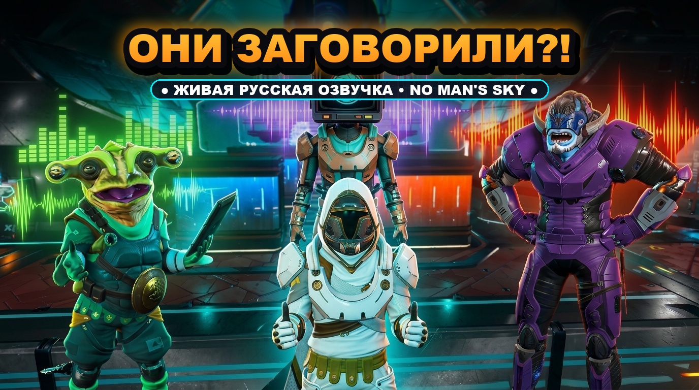

# NMS_READER // No Man's Sky Neural Lore Companion (C# / .NET 8)

Автономный нативный компаньон для **No Man's Sky** на **C# (.NET 8 WPF)** с локальной нейросетевой озвучкой сюжета, мыслей персонажа и диалогов пришельцев. Работает 100% локально без интернета.

---

## 🚀 Запуск программы

Запустите [**`NMS_Reader.exe`**](NMS_Reader.exe):
* Чистый автономный исполняемый файл без консолей и питоновских зависимостей.
* Быстрый локальный нейродвижок **Piper TTS** на базе ONNX Runtime.
* Автоматическое распознавание рас по цвету реплик (зелёный — Гек, красный — Вай'кин, сиреневый — Корвакс, белый — мысли скафандра).
* Умная детекция завершения печати диалога по внутриигровой иконке готовности страницы ($\lor$) и меню выбора.
* Поддержка пользовательских профилей и пресетов с сохранением конфигураций.

---

## 🎮 Управление в игре (Hands-Free)

| Действие / Клавиша | Функция |
| :--- | :--- |
| **Удержание `E` (500 мс+)** | Обычное взаимодействие с NPC или терминалом в No Man's Sky. Автоматически активирует распознавание и читает сюжет сразу после завершения вывода текста. |
| **`F3`** | **Мгновенный Стоп (Hard Stop)**. Сразу же прерывает текущую речь и отменяет очередь диалога (0 мс). |
| **`F4`** | Принудительное ручное сканирование экрана. |
| **`_` (Минимизация)** | Сворачивание в трей Windows (возле часов). |
| **`X` (Крестик)** | Полное завершение работы программы. |

---

## 🎭 Персонажи, расы и объекты No Man's Sky

В приложении предустановлены фирменные голосовые профили с кинематографической DSP-обработкой:

* **[👩 Женский скафандр]** — спокойный, чистый бортовой голос экзокостюма (Ирина, естественный тембр, мягкий ламповый драйв, интерком шлема).
* **[👨 Мужской скафандр]** — глубокий бархатный баритон скафандра (Руслан, ~120 Гц, +3 dB бас, легкая реверберация 5%, чистый интерком).
* **[🛰️ Артемида]** — голографический дрон-передатчик через космическую связь (Ирина, pitch 1.06x, скорость 1.10x, бас +5 dB, четкость +6 dB, теплый драйв, кибер-модуляция и интерком).
* **[🐸 Торговец Гек]** — характерный «лягушачий» горловой голос амфибии-торговца: выраженный резонаторный формантный пик (880 Гц), булькающее кваканье горлового мешка (22 Гц тремоло), бодрый коммерческий темп.
* **[🤖 Корвакс]** — кибернетическая модуляция мыслящей машины (роботизированный синтезатор с дроном 65 Гц).
* **[⚔️ Воин Вай'кин]** — могучий, брутальный голос воина (Павел, 1.00x, хлёсткая атака на согласных, яростные боевые интонации).
* **[🌌 Раса Странников]** — чистый, глубокий философский голос Аномалий/Странников (Дмитрий, естественный студийный звук).
* **[🌌 Монолит Атласа]** — монументальный космический гул по точному эталону: Ирина, тон (0.74x), скорость (0.90x), бас (+2 dB), максимальная четкость (ВЧ +10 dB), кибер-дрон модуляция, глубокий объем реверберации (40%), холодная сдержанность (NoiseScale 0.20) и паузы (0.40 с).

---

## 💾 Система профилей и пресетов

* **Заводской пресет (Factory Defaults)** — эталонные настройки рас и скафандра, защищенные от случайного изменения или удаления.
* **Пользовательские пресеты** — возможность создавать собственные конфигурации ("Пресет 1", "Пресет 2" и др.), настраивать любые параметры рас, мыслей персонажа и DSP-эффектов, сохранять и переключаться между ними в один клик.
* **Индикация активного пресета** — наглядная метка `[АКТИВЕН]`, показывающая текущий профиль, применяемый при чтении lore-текста.

---

## 🎛️ Студийный аудио-рэк и тонкие настройки речи

В приложении выведены все ключевые параметры синтеза и DSP-обработки:

| Ползунок / Параметр | Диапазон | Назначение |
| :--- | :--- | :--- |
| **Рация шлема (Интерком)** | `0%` – `100%` | Плавный подмес интеркома экзокостюма: от 0% (кристальный чистый звук) до 100% (характерная переговорная рация шлема). |
| **Живость / Эмоции (`NoiseScale`)** | `0.20` – `1.00` | Контролирует вариативность интонаций нейросети: от ровного сосредоточенного шепота до живой эмоциональной речи. |
| **Паузы между мыслями (`SentenceSilence`)** | `0.10 с` – `0.80 с` | Время затишья между предложениями и абзацами мыслей персонажа. |
| **Объем (Реверберация)** | `0%` – `60%` | Акустический объем помещения без навязчивого эхо (эффект зала, пещеры или монолита). |
| **Высота тона (Pitch)** | `0.70x` – `1.40x` | Фазовый вокодер сдвига частоты основного тона. |
| **Бас / Глубина** | `-6 dB` – `+10 dB` | Низкочастотный шельфовый фильтр 160 Гц (добавляет вес и бархат голосу). |
| **Четкость (ВЧ)** | `-6 dB` – `+10 dB` | Высокочастотный шельфовый фильтр 3800 Гц (подчеркивает разборчивость и воздух). |

---

## 🎙️ Локальные нейромодели в комплекте (`Voices/`)

1. **`ru_RU-dmitri-medium.onnx`** — Дмитрий [Странник / Аномалия] (глубокий естественный мужской голос).
2. **`ru_RU-ruslan-medium.onnx`** — Руслан [Мужской скафандр] (уверенный бархатный баритон ~120 Гц).
3. **`ru_RU-irina-medium.onnx`** — Ирина [Женский скафандр / Артемида / Атлас] (чистый женский голос).
4. **`ru_RU-pavel-medium.onnx`** — Павел [Вай'кин] (мощный низкий мужской тембр).

---

## 🗺️ Дорожная карта и развитие

Подробный план улучшений, этапы оптимизации скорости старта речи, интеграции словаря игры и микро-мода зафиксированы в [**`ROADMAP.md`**](ROADMAP.md).
